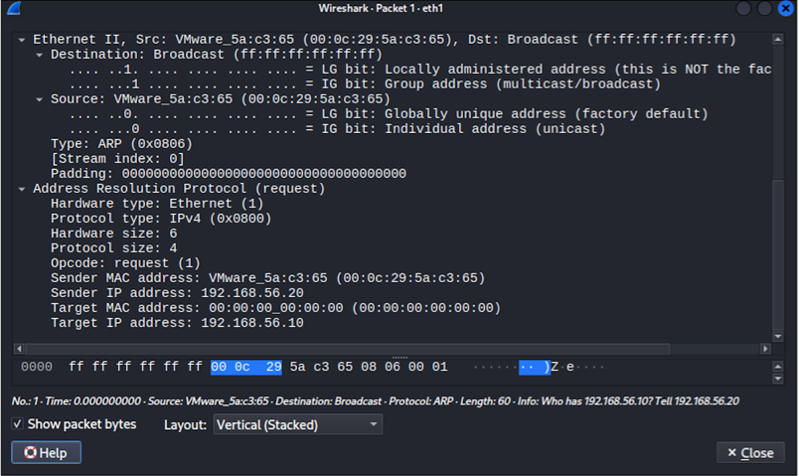
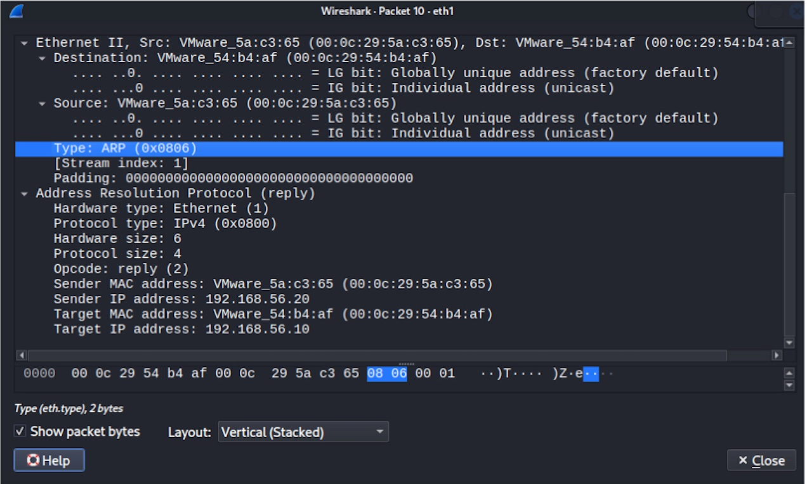

# ARP Request / Reply Packet Analysis

## 1. Objective

ARP Request와 ARP Reply 패킷을 직접 캡처하여 IP 주소와 MAC 주소가 어떻게 매핑되는지 확인한다.

Wireshark와 tcpdump를 이용하여 ARP 패킷의 주요 필드를 분석하였다.

---

## 2. Packet Capture

Wireshark에서 다음 필터를 사용하였다.
`arp`

또한 CLI 환경에서는 tcpdump를 사용하여 패킷을 캡처하였다.
```bash
sudo tcpdump -i eth1 -vvv -e arp
```

---

## 3. ARP Request Packet Analysis



| Field | Value |
| :--- | :--- |
| **Opcode** | Request (1) |
| **Sender MAC** | `00:0c:29:5a:c3:65` |
| **Sender IP** | `192.168.56.20` |
| **Target MAC** | `00:00:00:00:00:00` |
| **Target IP** | `192.168.56.10` |

Ubuntu(`192.168.56.20`)가 `192.168.56.10`의 MAC 주소를 알아내기 위해 ARP Request를 전송하였다.

Wireshark에서도 다음과 같이 확인할 수 있다.

`who has 192.168.56.10? Tell 192.168.56.20`

Sender는 자신의 MAC과 IP를 알고 있지만, Target의 MAC 주소는 아직 알지 못한다. 따라서 Target MAC Address는 `00:00:00:00:00:00`으로 설정되어있다.

---

## 4. ARP Reply Packet Analysis



| Field | Value |
| :--- | :--- |
| **Opcode** | Reply (2) |
| **Sender MAC** | `00:0c:29:5a:c3:65` |
| **Sender IP** | `192.168.56.20` |
| **Target MAC** | `00:0c:29:54:b4:af` |
| **Target IP** | `192.168.56.10` |

캡처된 ARP Reply에서는 Sender IP가 192.168.56.20, Target IP가 192.168.56.10으로 확인된다.

또한 Sender MAC은 00:0c:29:5a:c3:65, Target MAC은 00:0c:29:54:b4:af로 확인된다.

Request와 달리 1:1 유니캐스트(Unicast)로 전송되며, Target MAC Address 필드에 실제 응답 장비의 MAC 주소(`00:0c:29:54:b4:af`)가 채워진 것을 확인할 수 있다.

---

## 5. ARP Request vs ARP Reply Comparison

| 항목 (Field) | ARP Request | ARP Reply |
| :--- | :--- | :--- |
| **Opcode** | `request (1)` | `reply (2)` |
| **전송 방식 (Destination)** | **Broadcast** (`ff:ff:ff:ff:ff:ff`) | **Unicast** (요청자의 MAC) |
| **전송 목적** | IP에 대치되는 MAC 주소 **요청** | 요청받은 IP의 MAC 주소 **응답** |
| **Target MAC** | `00:00:00:00:00:00` (알 수 없는 상태) | `00:0c:29:54:b4:af` (실제 MAC 주소) |

---

## 6.Summary & Learned

ARP는 IPv4 주소를 기반으로 해당 장치의 MAC 주소를 확인하기 위해 사용된다.
ARP Request에서는 Target의 MAC 주소를 알 수 없기 때문에 Broadcast를 통해 특정 IP 주소의 MAC 주소를 요청한다.
ARP Reply에서는 확인된 MAC 주소 정보를 요청한 호스트에게 전달하며, 일반적으로 Unicast 방식으로 전송된다.
이번 실습에서는 Wireshark와 tcpdump를 이용하여 ARP Request와 ARP Reply의 Opcode, Sender/Target IP 및 MAC 주소를 직접 확인하면서 ARP의 IP-MAC 주소 매핑 과정을 패킷 수준에서 분석하였다


