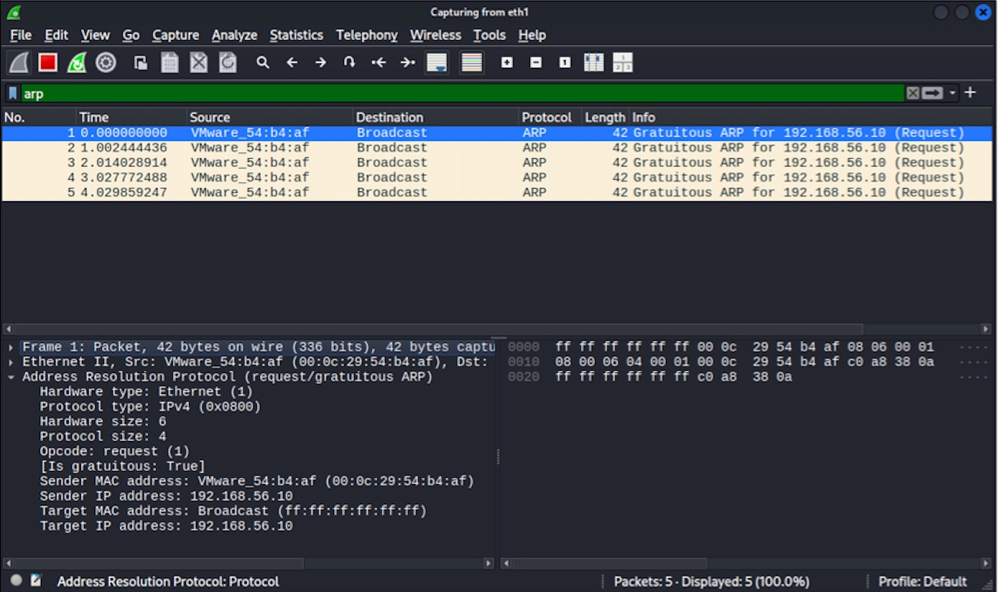

# Gratuitous ARP Analysis

## 1. What is Gratuitous ARP?

Gratuitous ARP(GARP)는 다른 호스트의 MAC 주소를 조회하기 위한 일반적인 ARP Request와 달리, 자신의 IP-MAC 주소 정보를 네트워크에 알리기 위해 별도의 요청 없이 전송되는 ARP 패킷이다.

---

## 2. Packet Structure & Differences

### Packet Comparison

- **Normal ARP Request**: 일반적으로 자신의 IP 주소(Sender IP)에 대한 상대방의 IP 주소(Target IP)의 MAC 주소를 요청하므로
  `Sender IP`와 `Target IP`가 서로 다르다.
- **Gratuitous ARP**: 자신의 IP-MAC 정보를 네트워크에 알리기 위해 `Sender IP`와 `Target IP`에 자신의 IP 주소를 사용하는 형태로 전송될 수 있다.

### Captured GARP Field

실습 패킷 분석에서 다음과 같이 **Sender IP와 Target IP가 동일한 특성**을 확인하였다.

| Field | Value |
| :--- | :--- |
| **Opcode** | `request (1)` |
| **Sender IP** | `192.168.56.10` |
| **Target IP** | `192.168.56.10` |
| **Ethernet Destination MAC** | `ff:ff:ff:ff:ff:ff` (Broadcast) |

---

## 3. Why is Gratuitous ARP used?

- **IP 충돌 확인**: 호스트가 IP 주소를 설정하는 과정에서 ARP 기반의 중복 주소 확인(Duplicate Address Detection)에 활용될 수 있다.
- **ARP Cache 갱신**: 다른 호스트가 자신의 ARP Cache에 해당 IP-MAC 매핑을 갱신하도록 유도할 수 있다.
- **주소 정보 알림**: 네트워크 인터페이스 변경이나 장애 조치(Failover) 등의 상황에서 자신의 최신 주소 정보를 주변 장비에 알리는 데 활용될 수 있다.

---

## 4. Security Perspective

ARP 프로토콜은 IP-MAC 매핑 정보를 검증하기 위한 기본적인 인증 메커니즘을 제공하지 않는다.
따라서 공격자가 위조된 ARP 정보를 네트워크에 전송하면 호스트의 ARP Cache에 잘못된 IP-MAC 매핑이 저장될 수 있다.
이러한 특성은 **ARP Spoofing** 및 **ARP Cache Poisoning**과 같은 공격에 악용될 수 있다.
특히 Gratuitous ARP를 위조하여 잘못된 IP-MAC 매핑 정보를 네트워크에 전달하는 방식으로 ARP Cache Poisoning 등에 악용할 수 있다.

