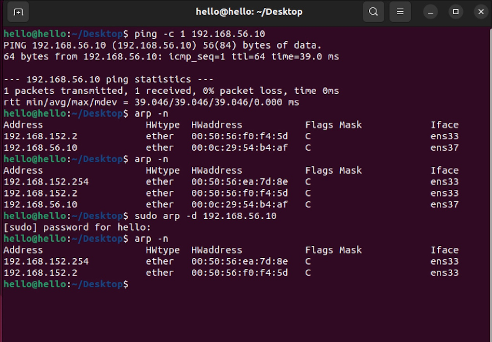

# ARP Cache Analysis

## 1. Objective

ARP Cache에 저장되는 IP-MAC 매핑 정보를 확인하고,
Cache의 상태 변화 및 삭제 동작을 실험을 통해 분석한다.

---

## 2. Check ARP Cache

`arp -n` 명령어를 통해 현재 시스템에 저장된 ARP 캐시 테이블을 확인하였다.

```bash
arp -n
```

---

## 3. ARP Cache Fields

| Field | Meaning |
| :--- | :--- |
| **Address** | 상대방 장비의 IP 주소 |
| **HWtype** | 물리적 네트워크 타입 (이더넷의 경우 `ether`) |
| **HWaddress** | 상대방 장비의 MAC 주소 |
| **Flags** | ARP Cache entry의 상태 및 속성을 나타내는 플래그 |
| **Iface** | 해당 ARP Cache entry가 연결된 네트워크 인터페이스 |

---

## 4. Experiment 

ARP Cache entry를 생성하기 위해 192.168.56.10으로 ping을 전송하였다.

```bash
ping -c 1 192.168.56.10
```

Ping이 정상적으로 완료된 후 arp -n 명령어를 통해 ARP Cache를 확인하였다.

```arp -n```

실습 결과 192.168.56.10에 대한 IP-MAC 매핑 정보가 ARP Cache에 저장된 것을 확인하였다.

---

## 5. Unexpected Result

일정 시간 대기한 후에도 ARP Cache entry가 바로 삭제되지 않는 것을 확인하였다.

> **Question**  
> 일정 시간이 지났는데 왜 ARP Cache entry가 바로 삭제되지 않을까?

---

## 6. Analysis (NUD Mechanism)

Linux 커널은 Neighbor Unreachability Detection (NUD) 메커니즘을 사용하여 Neighbor Cache의 상태를 관리한다.

따라서 ARP Cache entry가 일정 시간이 지났다고 해서 항상 즉시 삭제되는 것은 아니다.

* **Reachable 상태의 타이머 만료**: 일정 시간이 지나면 해당
  Neighbor entry는 `STALE` 상태로 변경될 수 있다.
* **상태 확인**: 이후 해당 Neighbor가 다시 사용되거나 검증이
  필요한 경우, 커널은 ARP 등을 이용하여 도달 가능성을 확인할 수 있다.
* **상태 변화**: 검증 결과에 따라 Neighbor entry의 상태가
  다시 `REACHABLE` 등으로 변경되거나, 도달할 수 없는 경우
  다른 상태로 전환될 수 있다.

이번 실습에서는 일정 시간 대기한 후에도 192.168.56.10에 대한 ARP Cache entry가 바로 삭제되지 않는 것을 확인하였다.
이를 통해 Linux의 Neighbor Cache가 단순히 일정 시간이 지나면 entry를 삭제하는 방식으로만 동작하는 것이 아니라, NUD를 통해 Neighbor의 상태와 도달 가능성을 관리한다는 점을 이해하였다.

---

## 7. Manual Cache Deletion

커널의 Neighbor Cache 동작을 확인한 후, 특정 ARP Cache entry를 수동으로 삭제하였다.

```bash
sudo arp -d 192.168.56.10
```

명령어 실행 후 ```arp -n``` 으로 다시 확인한 결과, 해당 IP 주소의 ARP Cache entry가 제거된 것을 확인하였다.

이를 통해 관리자가 특정 ARP Cache entry를 직접 삭제할 수 있음을 확인하였다.





---

## 8. Learned

ARP Cache는 네트워크 통신에서 반복적인 ARP 요청을 줄이기 위해 IP-MAC 매핑 정보를 저장한다.

또한 Linux에서는 단순히 일정 시간이 지나면 entry를 삭제하는 것이 아니라 NUD(Neighbor Unreachability Detection)를 이용하여
Neighbor의 상태와 도달 가능성을 관리한다는 점을 실습을 통해 이해하였다.

---

## 9.Security Perspective

ARP Cache는 IP와 MAC 주소의 매핑 정보를 저장하기 때문에 공격자가 잘못된 매핑 정보를 주입하면 ARP Cache Poisoning 공격으로 이어질 수 있다.
따라서 ARP Cache의 정상적인 생성과 관리 과정을 이해하는 것은 ARP Spoofing 및 ARP Cache Poisoning과 같은 네트워크 공격을 이해하는 데 중요한 기초가 된다.


