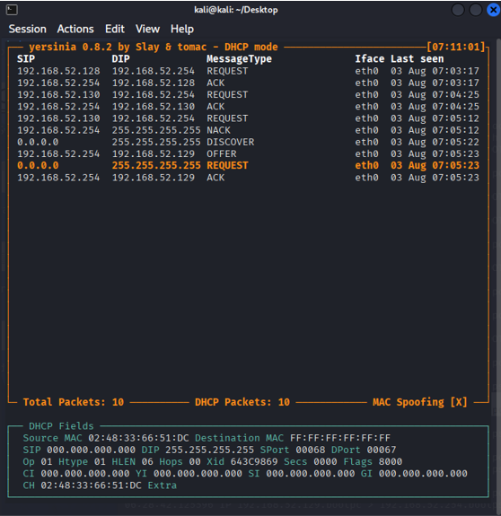
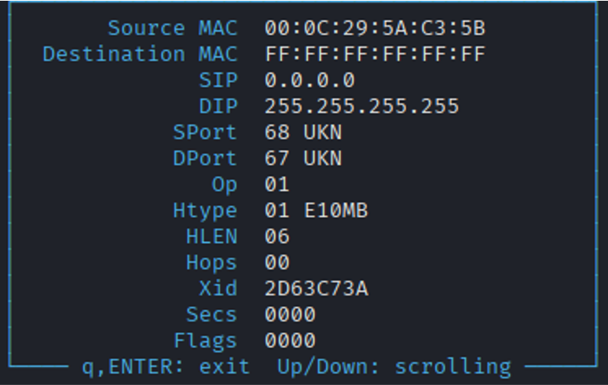
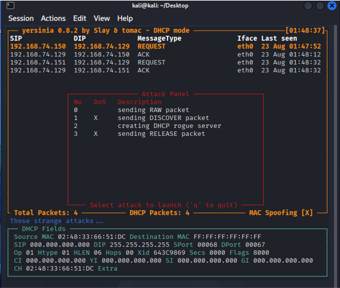
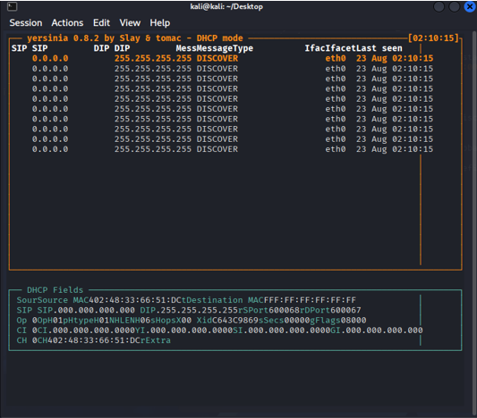

# DHCP & DHCP Starvation Analysis

## 1. Objective

DHCP(Dynamic Host Configuration Protocol)의 기본적인 동작 과정을 이해하고,
Yersinia를 활용하여 DHCP Starvation 공격이 발생하는 원리와 DHCP 서버의 IP 자원이 고갈되는 과정을 실습을 통해 확인한다.

---

## 2. What is DHCP?

DHCP(Dynamic Host Configuration Protocol)는 
네트워크에 연결된 장치에 IP 주소와 같은 네트워크 설정을
자동으로 할당해 주는 프로토콜이다.

DHCP의 기본적인 IP 할당 과정은 **DORA**라고 하며,
다음과 같은 순서로 동작한다.

```text
Client                         DHCP Server

   |                                |
   |-------- DHCP Discover -------->|
   |                                |
   |<--------- DHCP Offer ----------|
   |                                |
   |-------- DHCP Request --------->|
   |                                |
   |<---------- DHCP ACK -----------|
   |                                |
```

| Message           | Direction       | Purpose                       |
| :---------------- | :-------------- | :---------------------------- |
| **DHCP Discover** | Client → Server | DHCP 서버를 찾기 위한 요청             |
| **DHCP Offer**    | Server → Client | DHCP 서버가 IP 주소 등의 설정을 제안      |
| **DHCP Request**  | Client → Server | 제안받은 설정을 사용하겠다는 요청            |
| **DHCP ACK**      | Server → Client | DHCP 서버가 요청을 승인하고 네트워크 설정을 할당 |

---

### 3. DHCP Starvation

>>What is DHCP Starvation?

DHCP Starvation Attack은 DHCP 서버가 보유하고 있는
IP 주소를 반복적으로 할당하게 만들어 IP Pool을 고갈시키고,
정상적인 사용자가 IP 주소를 할당받지 못하도록 방해하는 공격이다.

공격자는 여러 개의 가짜 MAC 주소를 사용하여
DHCP Discover 또는 Request를 반복적으로 발생시킨다.

DHCP 서버는 서로 다른 MAC 주소를 사용하는 요청을
서로 다른 클라이언트의 요청으로 인식할 수 있으며,
이 과정에서 IP 주소가 계속 할당되면서 DHCP 서버의
사용 가능한 IP Pool이 감소하게 된다.

```
가짜 MAC 주소 생성
        ↓
DHCP Discover / Request 반복
        ↓
DHCP Server가 새로운 클라이언트로 인식
        ↓
IP Lease 할당
        ↓
IP Pool 감소
        ↓
IP Pool 고갈
        ↓
정상 사용자의 IP 할당 방해
```

## 4. Lab Environment

실습 환경은 VMware에서 Kali Linux와 Ubuntu Desktop을 구성하고,
두 시스템을 Host-Only Network로 연결하였다.

Host-Only Network를 사용하여 외부 네트워크와 분리된 환경에서
DHCP 통신 및 공격 과정을 확인하였다.

```
Environment
Attacker: Kali Linux
Client: Ubuntu Desktop
Virtualization: VMware
Network: Host-Only Network
Tool: Yersinia
```

---

## 5. Yersinia DHCP Mode

DHCP 관련 패킷을 확인하고 공격을 수행하기 위해 Yersinia를 사용하였다.

Yersinia의 DHCP Mode에서는 DHCP Request, ACK, Discover, Offer 등의 DHCP 메시지를 확인할 수 있다.



---

## 6. DHCP Discover Packet Analysis

Yersinia에서 확인한 DHCP Discover 패킷을 분석하였다.



```
| Field              | Value               |
| :----------------- | :------------------ |
| **Source MAC**     | `00:0C:29:5A:C3:5B` |
| **Source IP**      | `0.0.0.0`           |
| **Destination IP** | `255.255.255.255`   |
| **Protocol**       | UDP                 |
| **Client Port**    | `68`                |
| **Server Port**    | `67`                |
```

아직 IP 주소를 할당받지 않은 클라이언트는 source IP를 0.0.0.0으로 사용한다.

또한 DHCP 서버를 찾기 위해 Destination IP 255.255.255.255로 브로드캐스트한다.

DHCP는 UDP를 사용하며, 클라이언트는 UDP 68번 포트, 서버는 UDP 67번 포트를 사용한다.

---

## 7. Why MAC Address Matters

DHCP 서버는 클라이언트를 식별하기 위해 MAC 주소 등의 정보를 사용할 수 있다.

따라서 공격자는 여러 개의 가짜 MAC 주소를 사용하여 서로 다른 클라이언트처럼 DHCP 요청을 반복적으로 발생시킬 수 있다.

이러한 특성이 DHCP Starvation 공격으로 이어지는 중요한 원인이 된다.

---

## 8. DHCP Starvation Attack

Yersinia를 이용하여 다수의 DHCP 요청을 발생시켰다.



실습 화면에서 DHCP Discover 요청이 지속적으로 발생하는 것을 확인하였다.



이처럼 반복적으로 새로운 DHCP 클라이언트 요청이 발생하면서 DHCP 서버가 보유하고 있는 IP Lease가 계속 할당되는 상황을 만들었다.

---

## 9. DHCP Pool Exhaustion

공격 이후 DHCP 서버의 로그를 확인하여 IP Pool이 고갈되는 결과를 확인하였다.

DHCP 서버에서 다음과 같은 메시지를 확인하였다.

```
No free leases
```
No free leases는 DHCP 서버에서 더 이상 할당할 수 있는 IP Lease가 없다는 의미이다.

따라서 실습을 통해 DHCP Starvation 공격으로 인해 DHCP 서버의 할당 가능한 IP 자원이 고갈되는 과정을 확인하였다.

---

## 10. Attack Mechanism

이번 실습에서 확인한 DHCP Starvation 공격의 과정을 정리하면 다음과 같다.

```
Attacker
   ↓
여러 개의 가짜 MAC 주소 사용
   ↓
DHCP Discover / Request 반복 발생
   ↓
DHCP Server
   ↓
각 요청을 서로 다른 클라이언트로 인식
   ↓
IP Lease 반복 할당
   ↓
DHCP IP Pool 고갈
   ↓
정상 사용자의 IP 할당 방해
```

즉, DHCP Starvation 공격의 핵심은 **다수의 가짜 클라이언트 요청을 발생시켜 DHCP 서버의 IP 자원을 고갈시키는 것**이다.

---

## 11. Countermeasures

DHCP Snooping

스위치에서 DHCP 패킷을 검사하여 비정상적인 DHCP 요청이나 응답을 차단하는 데 활용할 수 있다.

Port Security

스위치 포트별로 사용할 수 있는 MAC 주소의 개수를 제한하여 비정상적으로 많은 MAC 주소가 사용되는 상황을 방지할 수 있다.

DHCP Request Rate Limiting

하나의 포트에서 짧은 시간 동안 과도한 DHCP 요청이 발생하는 경우 요청 속도를 제한하거나 차단하여 비정상적인 DHCP 요청의 발생을 줄일 수 있다.

---

## 12. Security Perspective

DHCP는 네트워크에 연결된 장치에
IP 주소를 자동으로 할당하는 중요한 프로토콜이지만,
DHCP 서버가 관리하는 IP Pool은 공격의 대상이 될 수 있다.

DHCP Starvation 공격에서는 다수의 가짜 MAC 주소를 이용하여
DHCP 서버의 IP 자원을 소모시키고,
결과적으로 정상 사용자의 IP 주소 할당을 방해할 수 있다.

따라서 DHCP를 학습할 때는 정상적인 DORA 과정뿐만 아니라
DHCP 서버의 자원 관리와 이를 악용한 공격 가능성까지
함께 이해할 필요가 있다.

---

## 13. Learned

이번 실습을 통해 DHCP의 기본적인 IP 주소 할당 과정인
DORA(Discover → Offer → Request → ACK) 를 이해하였다.

또한 Yersinia를 이용하여 DHCP Discover 요청이 반복적으로 발생하는
상황을 확인하고, 최종적으로 DHCP 서버에서
No free leases 메시지가 발생하는 것을 통해
IP Lease가 고갈되는 결과를 확인하였다.

이를 통해 DHCP Starvation 공격이
가짜 MAC 주소를 이용한 반복적인 DHCP 요청으로
DHCP 서버의 IP Pool을 고갈시키는 공격이라는 점을 이해하였다.

또한 DHCP Snooping과 Port Security 등의 네트워크 보안 기능을 통해
이러한 공격을 방어할 수 있다는 점을 학습하였다.


