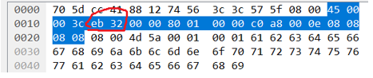
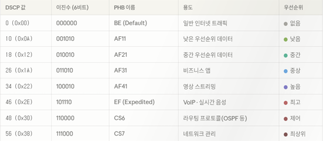

# IP Protocol

IPv4 프로토콜의 헤더 구조를 이해하고, Hex Dump를 이용한 IP Header 파싱과 IP Fragmentation, DSCP/ECN/PHB를 학습한 내용을 정리한다.

---

# 1. IPv4 Header Parsing



```
IPv4 Header
┌────────┬────────┬────────────────────┐
│Version │  IHL   │      ...           │
├────────┴────────┼────────────────────┤
│     Total Length                     │
├──────────────────────────────────────┤
│        TTL       │ Protocol │ ...    │
├──────────────────────────────────────┤
│          Source IP Address           │
├──────────────────────────────────────┤
│       Destination IP Address         │
└──────────────────────────────────────┘
```

Hex Dump를 보고 IP Header의 주요 필드 값을 파싱하여 10진수로 변환한다.

## Version : 4 (IPv4)

그림의 첫 번째 바이트 `45` 중 상위 4비트는 IP 프로토콜의 버전을 나타낸다.

```text
0x45
→ 0100 0101
   ↑
 Version
```

16진수 `4`는 10진수로도 `4`이다.

따라서 Version은 **4(IPv4)**이다.

---

## Header Length : 20 bytes

첫 번째 바이트 `45`의 하위 4비트인 `5`는 IP Header의 길이를 나타낸다.

IP Header의 길이는 4바이트(32비트) 단위로 표현한다.

따라서:

```text
5 × 4 byte = 20 byte
```

따라서 IP Header Length는 **20바이트**이다.

---

## Total Length : 60 bytes

그림의 `00 3c` 부분은 전체 IP 패킷의 길이를 의미한다.

IP Header와 상위 계층 데이터(ICMP 등)를 모두 포함한 전체 패킷의 크기이다.

`00 3c`를 10진수로 변환하면:

```text
0x003c

= (0 × 16³)
+ (0 × 16²)
+ (3 × 16¹)
+ (12 × 16⁰)

= 48 + 12
= 60
```

따라서 Total Length는 **60바이트**이다.

---

## TTL : 128

그림의 `80`(9번째 바이트)은 Time To Live(TTL)를 의미한다.

TTL은 패킷이 라우터를 통과할 때마다 1씩 감소하며, 0이 되면 패킷이 폐기된다. 이를 통해 라우팅 루프를 방지한다.

16진수 `80`을 10진수로 변환하면:

```text
0x80

= (8 × 16¹)
+ (0 × 16⁰)

= 128
```

따라서 TTL은 **128**이다.

---

## Protocol : 1 (ICMP)

그림의 `01`(10번째 바이트)은 상위 프로토콜 타입을 의미한다.

IP Header 뒤에 어떤 상위 계층 프로토콜 데이터가 캡슐화되어 있는지를 나타낸다.

```text
0x01 = 1
```

프로토콜 번호 `1`은 **ICMP**를 의미한다.

따라서 Protocol은 **1 (ICMP)**이다.

---

## Source IP : 87.95.8.0

그림의 `57 5f 08 00` 부분은 출발지 IP 주소를 의미한다.

IPv4 주소는 4바이트(32비트)로 구성되며, 각 바이트를 10진수로 변환한 뒤 점(`.`)으로 연결한다.

```text
57 → (5 × 16) + 7
   = 87

5f → (5 × 16) + 15
   = 95

08 → 8

00 → 0
```

따라서 Source IP는:

```text
87.95.8.0
```

이다.

---

## Destination IP : 77.90.0.1

그림의 `4d 5a 00 01` 부분은 목적지 IP 주소를 의미한다.

각 바이트를 10진수로 변환하면:

```text
4d → (4 × 16) + 13
   = 77

5a → (5 × 16) + 10
   = 90

00 → 0

01 → 1
```

따라서 Destination IP는:

```text
77.90.0.1
```

이다.

---

# 2. IPv4 Fragmentation

```
Original Packet
┌───────────────────────────────┐
│ IP Header │       3000 B      │
└───────────────────────────────┘
                ↓ Fragmentation

Fragment 1       Fragment 2       Fragment 3
┌──────────┐    ┌──────────┐    ┌──────────┐
│ Header   │    │ Header   │    │ Header   │
│ 1480 Data│    │ 1480 Data│    │  40 Data │
└──────────┘    └──────────┘    └──────────┘
 Offset 0         Offset 185      Offset 370
 MF = 1           MF = 1          MF = 0
```

원본 데이터가 MTU보다 큰 경우 하나의 IP 패킷으로 전송할 수 없기 때문에 여러 개의 Fragment로 나누어 전송한다.

주어진 조건:

```text
원본 데이터 = 3000 bytes / 5000 bytes
MTU = 1500 bytes
IP Header = 20 bytes
```

## 단편화 계산의 핵심 규칙

### 1. 최대 데이터 크기

MTU 1500바이트는 다음의 합이다.

```text
IP Header + 순수 데이터 ≤ 1500 bytes
```

IP Header가 20바이트이므로 하나의 Fragment에 포함할 수 있는 최대 순수 데이터 크기는:

```text
1500 - 20 = 1480 bytes
```

따라서 최대 데이터 크기는 **1480바이트**이다.

---

### 2. Fragment Offset은 8바이트 단위

Fragment Offset은 이전 Fragment까지 전송된 순수 데이터의 누적 크기를 8로 나누어 계산한다.

```text
Offset = 이전 Fragment까지의 데이터 누적 크기 ÷ 8
```

마지막 Fragment를 제외한 앞선 Fragment의 데이터 크기는 8의 배수여야 한다.

1480은:

```text
1480 ÷ 8 = 185
```

이므로 조건을 만족한다.

---

### 3. MF(More Fragments) Flag

MF Flag는 뒤에 Fragment가 더 존재하는지를 나타낸다.

```text
MF = 1 → 뒤에 Fragment가 더 있음
MF = 0 → 현재 Fragment가 마지막 Fragment
```

---

## 원본 데이터 3000 bytes

최대 데이터 크기인 1480바이트를 기준으로 나누면:

| Fragment | Data Size | Offset | MF |
| -------- | --------: | -----: | -: |
| 1        |      1480 |      0 |  1 |
| 2        |      1480 |    185 |  1 |
| 3        |        40 |    370 |  0 |

계산:

```text
3000 - 1480 - 1480 = 40
```

두 번째 Fragment까지 전송된 데이터:

```text
1480 + 1480 = 2960
```

따라서 세 번째 Fragment의 Offset:

```text
2960 ÷ 8 = 370
```

결과:

* Fragment 개수: **3개**
* 마지막 Fragment Offset: **370**
* 마지막 MF Flag: **0**
* 마지막 Fragment 데이터 크기: **40바이트**

---

## 원본 데이터 5000 bytes

| Fragment | Data Size | Offset | MF |
| -------- | --------: | -----: | -: |
| 1        |      1480 |      0 |  1 |
| 2        |      1480 |    185 |  1 |
| 3        |      1480 |    370 |  1 |
| 4        |       560 |    555 |  0 |

계산:

```text
5000 - 1480 - 1480 - 1480 = 560
```

세 번째 Fragment까지 전송된 데이터:

```text
1480 + 1480 + 1480 = 4440
```

따라서 네 번째 Fragment의 Offset:

```text
4440 ÷ 8 = 555
```

결과:

* Fragment 개수: **4개**
* 마지막 Fragment Offset: **555**
* 마지막 MF Flag: **0**
* 마지막 Fragment 데이터 크기: **560바이트**

---

# 3. DSCP / ECN / PHB

## DSCP



DSCP(Differentiated Services Code Point)는 IPv4의 ToS 관련 필드에서 **상위 6비트**를 사용하는 값이다.

네트워크 장비가 트래픽을 구분하고, 각 트래픽에 적절한 처리 방식(PHB)을 적용할 수 있도록 사용된다.

예를 들어 실시간 음성, 영상 스트리밍, 일반 데이터 등의 트래픽을 구분할 수 있다.

---

## ECN

ECN(Explicit Congestion Notification)은 **하위 2비트**를 사용하는 필드이다.

네트워크 장비에서 혼잡이 발생했을 때 패킷을 반드시 버리는 대신 송수신자에게 혼잡 상태를 전달하여 전송 속도를 조절할 수 있도록 하는 메커니즘이다.

ECN 값 0은 Non-ECT(Not ECN-Capable Transport)를 의미한다.
즉, 해당 패킷은 ECN을 사용할 수 있도록 표시되지 않은 상태이다.

---

## PHB

PHB(Per-Hop Behavior)는 DSCP 값에 따라 네트워크 장비가 패킷을 처리하는 방식을 의미한다.

라우터는 패킷의 DSCP 값을 바탕으로 해당 트래픽에 적용할 전송 및 큐잉 등의 처리 방식을 결정한다.

---

# 4. ToS = 0xB8 분석

```
ToS / DS Field (8 bits)

┌──────────────────────────┬──────┐
│        DSCP (6 bits)     │ ECN  │
│                          │2 bits│
└──────────────────────────┴──────┘
          101110             00
             ↓                ↓
          DSCP 46           ECN 0
```       

주어진 ToS 필드 값:

```text
0xB8
```

이를 8비트 이진수로 변환하면:

```text
B = 1011
8 = 1000

0xB8 = 1011 1000
```

DSCP는 상위 6비트, ECN은 하위 2비트이므로:

```text
101110 | 00
DSCP    ECN
```

---

## DSCP 값

상위 6비트:

```text
101110
```

이를 10진수로 변환하면:

```text
(1 × 2⁵)
+ (0 × 2⁴)
+ (1 × 2³)
+ (1 × 2²)
+ (1 × 2¹)
+ (0 × 2⁰)

= 32 + 0 + 8 + 4 + 2 + 0
= 46
```

따라서:

```text
DSCP = 46
```

---

## ECN 값

하위 2비트:

```text
00 = 0
```

따라서:

```text
ECN = 0
```

ECN 값 0은 **Non-ECT** 상태를 의미하며, 해당 통신에서는 ECN을 사용하지 않는 상태이다.

---

## PHB

DSCP 값 `46`은 **EF(Expedited Forwarding)** PHB에 해당한다.

EF는 **낮은 지연(Low Latency), 낮은 지터(Low Jitter), 낮은 패킷 손실**이 요구되는 트래픽을 처리하기 위한 PHB이다.

대표적으로 VoIP와 같은 실시간 음성 트래픽에 사용될 수 있다.

---

# 5. Key Takeaways

* IPv4 Header의 주요 필드를 Hex Dump에서 직접 파싱할 수 있다.
* IHL 값은 4바이트 단위로 계산한다.
* Total Length는 IP Header와 상위 계층 데이터를 포함한 전체 IP 패킷의 크기이다.
* TTL은 라우팅 루프를 방지하기 위해 라우터를 거칠 때마다 감소한다.
* Protocol 필드를 통해 IP 상위 계층의 프로토콜을 확인할 수 있다.
* IPv4 Fragmentation에서는 MTU와 IP Header 크기를 이용하여 최대 Fragment 데이터 크기를 계산할 수 있다.
* Fragment Offset은 8바이트 단위로 계산한다.
* MF Flag를 통해 뒤에 Fragment가 더 존재하는지 확인할 수 있다.
* ToS 관련 필드는 DSCP와 ECN으로 나누어 해석할 수 있다.
* `0xB8`의 DSCP 값은 **46**, ECN 값은 **0**이다.
* DSCP 46은 **EF(Expedited Forwarding)** PHB에 해당한다.

